<p align="center">
  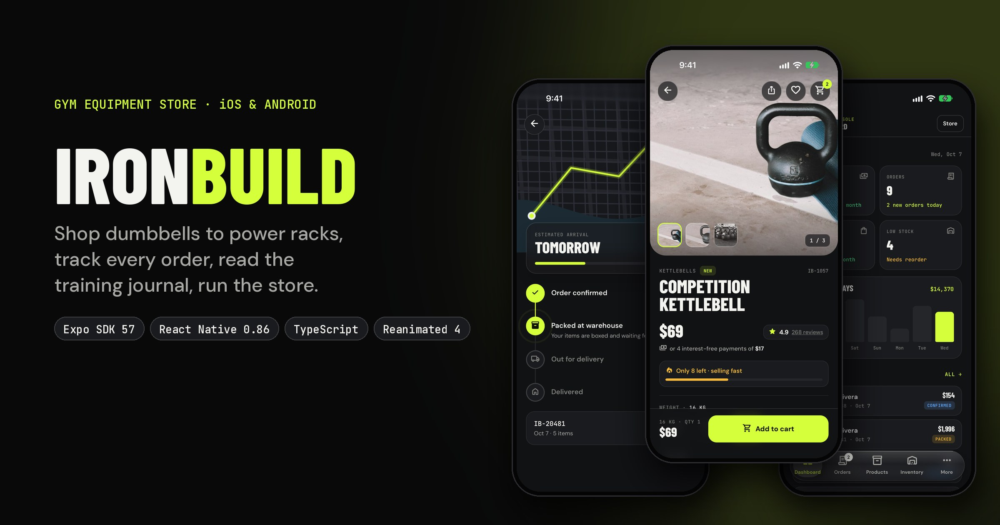
</p>

<h1 align="center">IRONBUILD</h1>

<p align="center">
  <strong>A premium gym-equipment store for iOS and Android</strong><br/>
  Shop dumbbells to power racks, follow every order to your door, read the training journal, and run the whole store from your phone.
</p>

<p align="center">
  
  
  
  
  
  
</p>

---

## Contents

- [What is IRONBUILD?](#what-is-ironbuild)
- [Screenshots](#screenshots)
- [Features](#features)
- [Tech stack](#tech-stack)
- [Getting started](#getting-started)
- [Trying the app](#trying-the-app)
- [Scripts](#scripts)
- [Project structure](#project-structure)
- [How it works](#how-it-works)
- [Customising](#customising)
- [Connecting a real backend](#connecting-a-real-backend)
- [Deep links](#deep-links)
- [Building for the stores](#building-for-the-stores)
- [Troubleshooting](#troubleshooting)
- [Credits & license](#credits--license)

---

## What is IRONBUILD?

IRONBUILD is a complete mobile commerce app for home and pro gym equipment. It is built from a pixel-level design spec (the **IRONBUILD App v2** prototype) and implemented with current Expo and React Native best practices.

It covers the full journey:

- **Shoppers** see an animated intro, browse and search the catalog, read product details and reviews, check out, and track their order on a map. They can also bookmark articles from the Training Journal.
- **Store owners** switch to a built-in **admin console** for orders, products, inventory, categories, customers, discounts, shipping, reports and settings.

Everything runs locally with realistic seed data, so you can clone it and use it straight away. All network calls go through one service file ([`src/services/api.ts`](src/services/api.ts)); that is where you plug in a real backend.

---

## Screenshots

<table>
  <tr>
    <td align="center">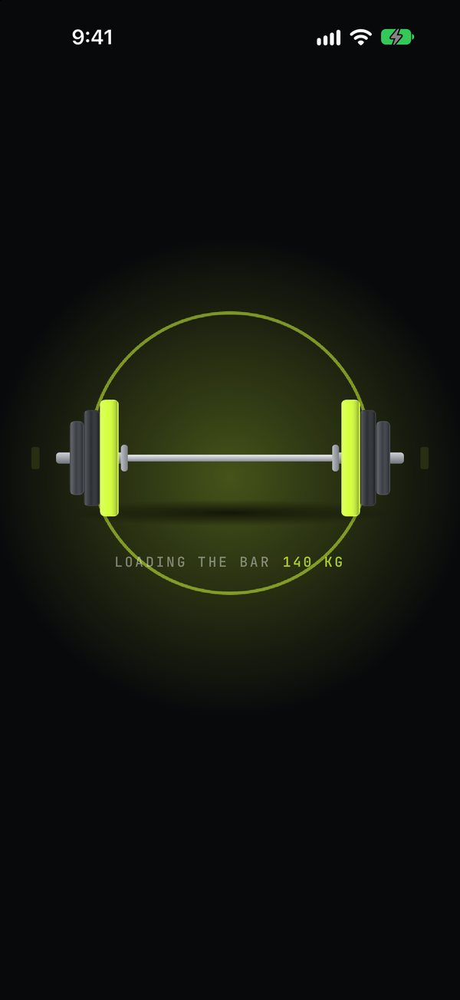<br/><sub><b>Animated intro</b></sub></td>
    <td align="center">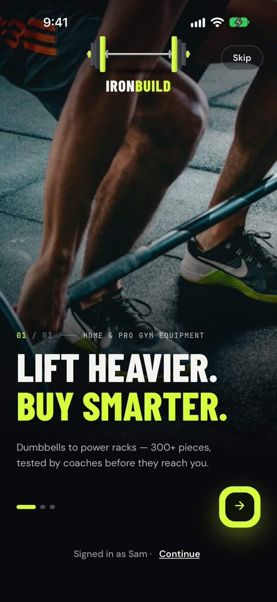<br/><sub><b>Onboarding</b></sub></td>
    <td align="center">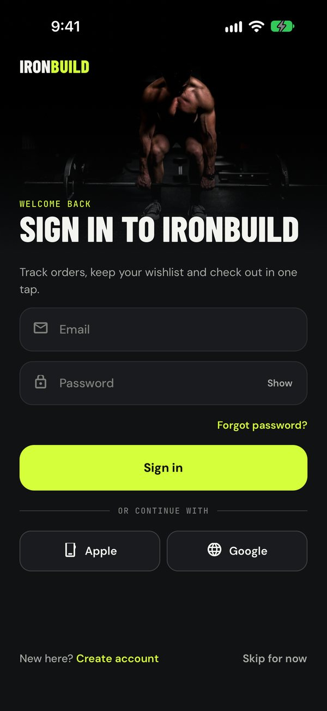<br/><sub><b>Sign in</b></sub></td>
    <td align="center">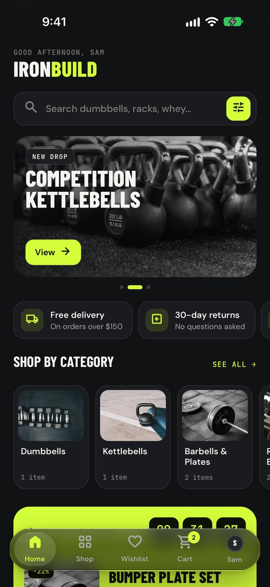<br/><sub><b>Home</b></sub></td>
  </tr>
  <tr>
    <td align="center">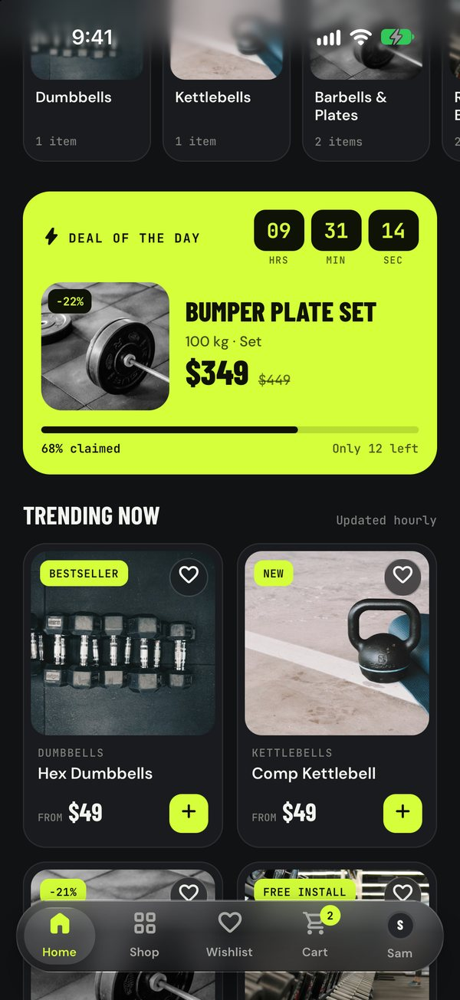<br/><sub><b>Deal of the day</b></sub></td>
    <td align="center">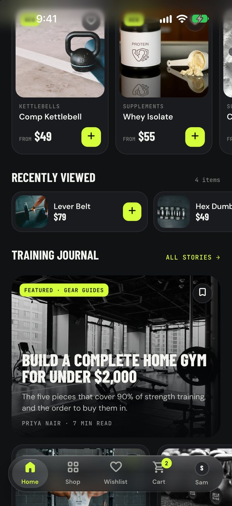<br/><sub><b>Journal on Home</b></sub></td>
    <td align="center">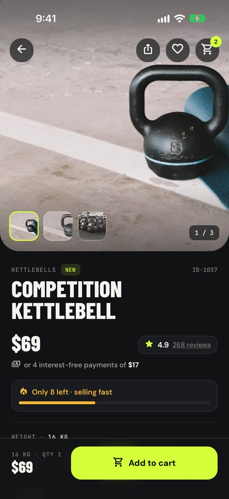<br/><sub><b>Product detail</b></sub></td>
    <td align="center">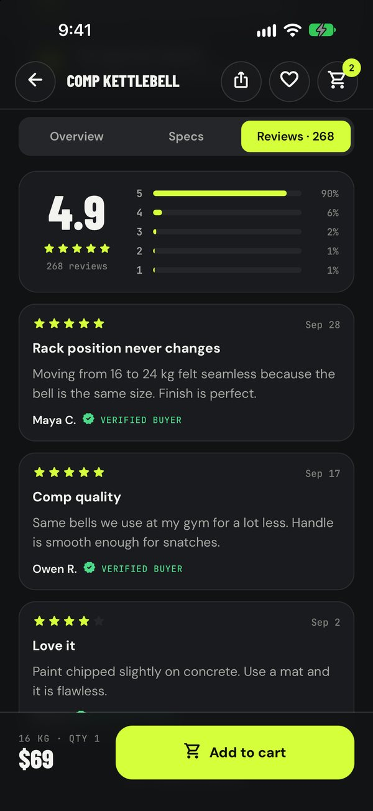<br/><sub><b>Reviews</b></sub></td>
  </tr>
  <tr>
    <td align="center">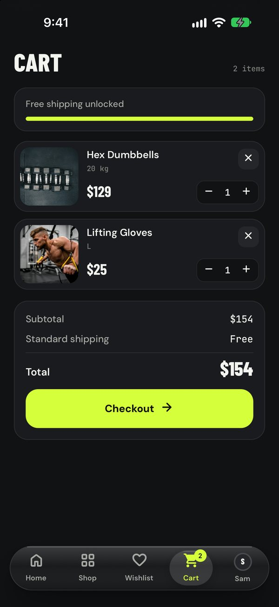<br/><sub><b>Cart</b></sub></td>
    <td align="center">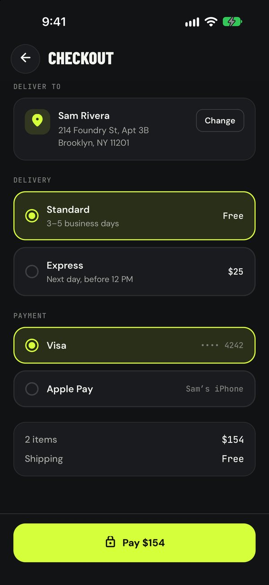<br/><sub><b>Checkout</b></sub></td>
    <td align="center">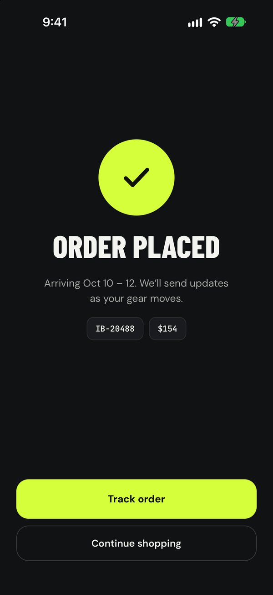<br/><sub><b>Order placed</b></sub></td>
    <td align="center">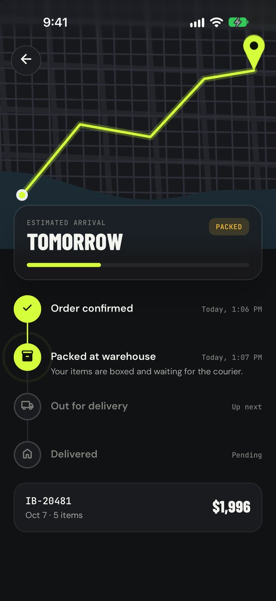<br/><sub><b>Live tracking</b></sub></td>
  </tr>
  <tr>
    <td align="center">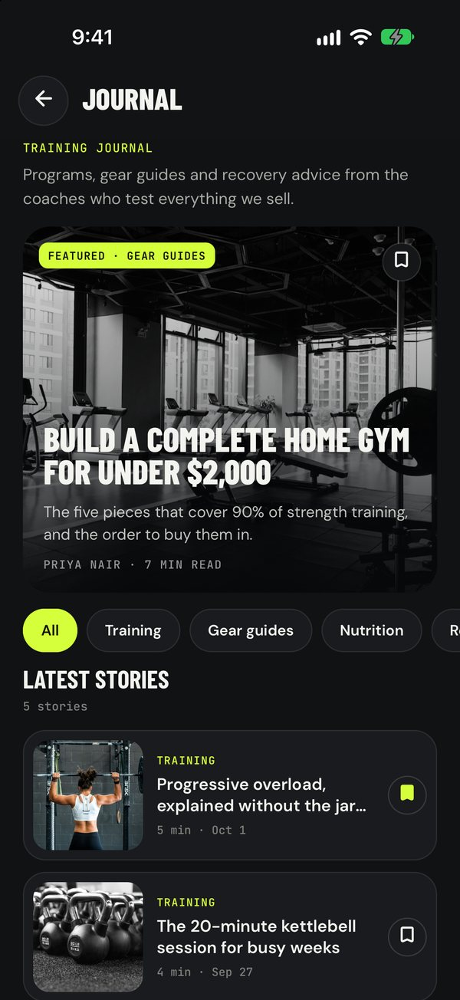<br/><sub><b>Training journal</b></sub></td>
    <td align="center">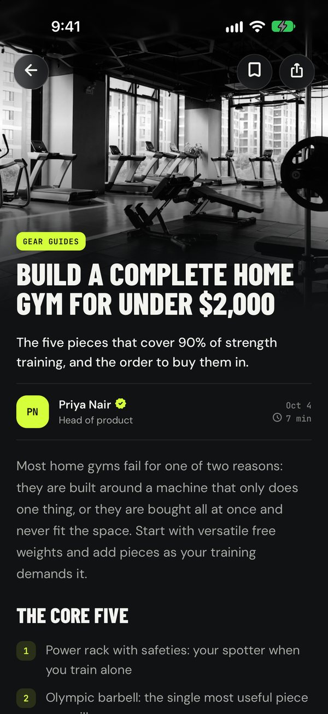<br/><sub><b>Article</b></sub></td>
    <td align="center">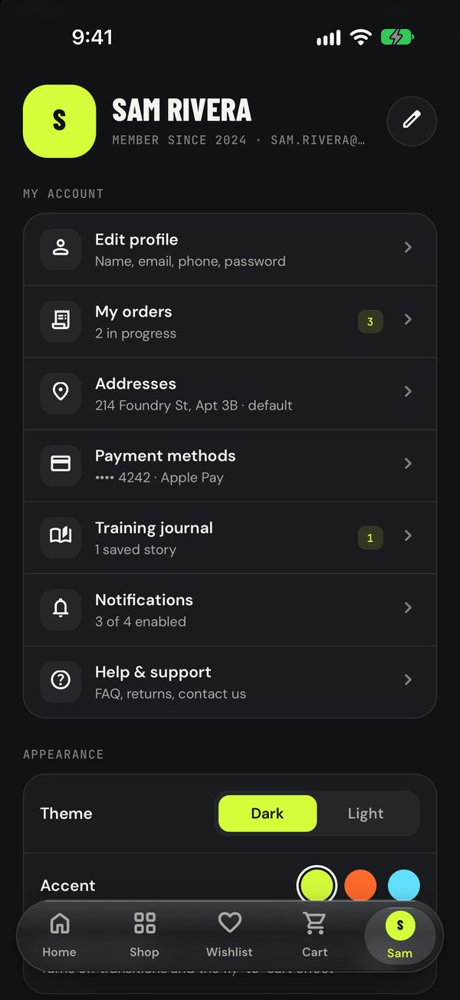<br/><sub><b>Profile</b></sub></td>
    <td align="center">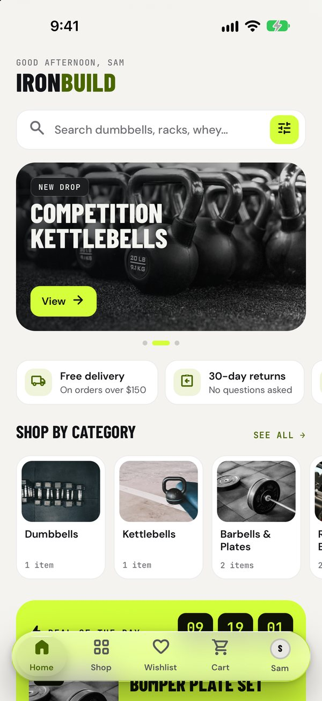<br/><sub><b>Light theme</b></sub></td>
  </tr>
  <tr>
    <td align="center">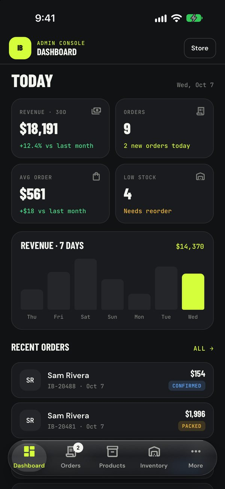<br/><sub><b>Admin dashboard</b></sub></td>
    <td align="center">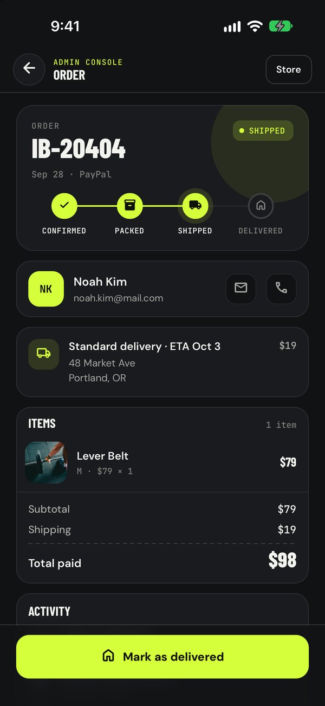<br/><sub><b>Admin order</b></sub></td>
    <td></td>
    <td></td>
  </tr>
</table>

---

## Features

### Onboarding & accounts
- **Animated intro**: a barbell loads, the plates slam on, the IRONBUILD wordmark rises, then the photo reveals into a three-slide onboarding (swipe or tap through). It plays on first launch only.
- Sign in with email or Apple/Google (simulated), create an account with a password-strength meter, and reset your password with a 6-digit code (iOS one-time-code autofill and paste supported).
- **Guest browsing**: "Skip for now" lets anyone shop before signing in.

### Storefront
- **Home**: personalised greeting, auto-advancing promo carousel, store-perks strip, category rail, **Deal of the day** with a live countdown, trending grid, **Just landed** rail, **Recently viewed**, Training Journal highlights, verified customer reviews and a newsletter sign-up.
- **Shop**: search, category chips, browse-by-category tiles, and a native **filter sheet** (sort, price slider, sale only) with a live result count.
- **Wishlist** with animated hearts, saved on the device.

### Product page
- Swipeable gallery with thumbnails, savings badge, a pay-in-4 line and a low-stock urgency meter.
- Option chips that show each option's price, plus a size guide for apparel.
- Delivery estimate in business days, pro-assembly and returns info.
- **Overview / Specs / Reviews** tabs: highlights, what's in the box, a full spec table, rating breakdown and verified reviews.
- Shipping, returns, warranty and care sections, **Frequently bought together** (add all in one tap), and **You might also like**.
- **Fly-to-cart**: a "+1" dot arcs into the cart and the badge bumps.

### Checkout & orders
- Cart with a free-shipping progress bar and quantity steppers; checkout with address, standard or express delivery, and payment method.
- An animated **Order placed** confirmation, then **live tracking** with a map, ETA card and step timeline.
- Order history under Profile → My orders.

### Training Journal (blog)
- Featured story, category filters (Training, Gear guides, Nutrition, Recovery), and **bookmarks** that survive restarts.
- Article pages with a parallax photo header, verified author, numbered lists, coach tips, pull quotes and **shoppable product cards**, plus native share and "Keep reading".

### Account
- Edit profile, addresses (choose the default), payment methods, notification preferences, and help & support with a mail link.
- **Appearance**: dark or light theme, three accent colours (Volt, Ember, Ice) and a **Reduce motion** switch. The app also follows the system's reduced-motion setting.

### Admin console
- **Dashboard**: revenue, orders, average order value, low stock, a 7-day revenue chart, recent orders and low-stock alerts.
- **Orders**: status filters with counts; the order detail moves an order through confirmed → packed → shipped → delivered, or cancels it after a confirmation prompt; email and call the customer.
- **Products** (create, edit, publish or hide, delete), **Inventory** steppers, **Categories** (hide from the store), **Customers**, **Discount codes**, **Shipping** rates and zones, **Reports**, **Settings**.

### Quality
- Strict TypeScript, ESLint and expo-doctor all pass, and the React Compiler is enabled.
- Accessibility labels, roles and states on interactive elements; the **Reduce motion** setting is respected everywhere.
- Haptics on key interactions.
- Every colour, radius and type size comes from the design tokens.

---

## Tech stack

| Area | Choice |
| --- | --- |
| Framework | [Expo SDK 57](https://docs.expo.dev), React Native 0.86 (New Architecture), React 19 with the React Compiler |
| Language | TypeScript (strict) |
| Navigation | [Expo Router](https://docs.expo.dev/router/introduction/): typed file-based routes, native stack, form sheets, headless `expo-router/ui` tabs with a custom glass tab bar |
| Animation | React Native Reanimated 4 + Worklets |
| Gestures | React Native Gesture Handler |
| State | Zustand 5 with `persist` → AsyncStorage |
| UI | expo-image (disk cache), expo-blur, expo-linear-gradient, react-native-svg, expo-haptics |
| Fonts | Barlow Condensed, DM Sans, JetBrains Mono (`@expo-google-fonts`) and Material Symbols Rounded (subset, bundled) |
| Tooling | ESLint (`eslint-config-expo`), `tsc`, `expo-doctor` |

---

## Getting started

### 1. Prerequisites

| Tool | Version |
| --- | --- |
| [Node.js](https://nodejs.org) | 20.19.4+, 22.13+ or 24.3+ (LTS recommended) |
| npm | Ships with Node |
| **iOS** (macOS only) | [Xcode](https://developer.apple.com/xcode/) with an iOS Simulator, plus [CocoaPods](https://cocoapods.org) |
| **Android** | [Android Studio](https://developer.android.com/studio) with an emulator (API 24+) and JDK 17 |
| Git | Any recent version |

> 💡 You don't need a global Expo CLI. Everything runs through `npx expo`.

### 2. Clone and install

```bash
git clone https://github.com/noorjsdivs/ironbuild.git
cd ironbuild
npm install
```

### 3. Run it

IRONBUILD uses native modules that aren't bundled in Expo Go, so it runs as a **development build**. The first build compiles the native app and takes a few minutes; after that, JavaScript changes reload instantly.

**iOS Simulator** (macOS):

```bash
npx expo run:ios
```

**Android emulator** (start an emulator in Android Studio first):

```bash
npx expo run:android
```

**Physical device**: plug in your phone and pass `--device` to pick it:

```bash
npx expo run:ios --device
```

After the first build, just start the dev server and open the installed app:

```bash
npm start
```

> **macOS tip:** if `pod install` fails with `Unicode Normalization not appropriate for ASCII-8BIT`, your shell isn't using UTF-8. Add `export LANG=en_US.UTF-8` to `~/.zshrc`, open a new terminal and run the command again.

---

## Trying the app

| What | How |
| --- | --- |
| **Sign in** | Use any email and password, or leave both empty. You'll be signed in as the demo shopper **Sam Rivera**. |
| **Verification code** | Any 6 digits work on the verify screen. |
| **Admin console** | Sign in, then go to **Profile → Admin console**. Tap **Store** to come back. |
| **Out-of-stock behaviour** | Try adding the **FID Bench**; its seed stock is 0. |
| **Replay the intro** | Delete the app (or clear its storage); the intro shows on first launch. |
| **Reset demo data** | Cart, orders, wishlist, bookmarks and admin edits are saved on the device. Delete and reinstall the app to start fresh. |

---

## Scripts

| Command | What it does |
| --- | --- |
| `npm start` | Start the Metro dev server |
| `npm run ios` | Build and run on the iOS Simulator (`expo run:ios`) |
| `npm run android` | Build and run on an Android emulator or device (`expo run:android`) |
| `npm run typecheck` | Type-check the project with `tsc --noEmit` |
| `npm run lint` | Lint with ESLint (`eslint-config-expo`) |
| `npm run doctor` | Check dependencies and config with `expo-doctor` |

Run `npm run typecheck && npm run lint && npm run doctor` before opening a pull request.

---

## Project structure

```
ironbuild/
├── src/
│   ├── app/                     # Routes (Expo Router, file-based)
│   │   ├── _layout.tsx          # Fonts, storage hydration, theme, root stack, toast + fly-to-cart overlays
│   │   ├── welcome.tsx          # Animated intro → onboarding (first launch)
│   │   ├── (auth)/              # login · register · forgot-password · verify  (modal stack)
│   │   ├── (tabs)/              # Home · Shop · Wishlist · Cart · Profile
│   │   ├── product/[id].tsx     # Product detail
│   │   ├── filters.tsx          # Native form sheet
│   │   ├── checkout.tsx · order-placed.tsx · track/[no].tsx
│   │   ├── journal/             # Training Journal index + article pages
│   │   ├── account/             # Edit profile · orders · addresses · payments · notifications · help
│   │   └── admin/               # Owner console (only reachable when signed in)
│   │       ├── (tabs)/          # Dashboard · Orders · Products · Inventory · More
│   │       └── …                # order/[no] · product/[id] · categories · customers · discounts · shipping · reports · settings
│   ├── components/              # Design-system and feature components
│   ├── data/                    # Seed catalog, product details, journal articles, reviews, types
│   ├── hooks/                   # Add-to-cart (fly animation), shop filtering, admin stats
│   ├── lib/                     # Formatting, pricing, status helpers
│   ├── services/api.ts          # ⭐ Backend seam: auth + orders (simulated latency today)
│   ├── store/                   # Zustand app store (saved on device) + UI store (toast, browse state)
│   └── theme/                   # Tokens (dark/light × 3 accents), typography, motion presets
├── assets/                      # App icon, splash, bundled icon fonts, map image
├── plugins/                     # Local Expo config plugins (iOS scene lifecycle)
├── docs/                        # README banner and screenshots
└── app.json                     # Expo app config
```

---

## How it works

<details>
<summary><b>Navigation map</b></summary>

```
Root Stack
├── (tabs)            Home · Shop · Wishlist · Cart · Profile   ← custom glass tab bar
├── welcome           full-screen modal, first launch only
├── (auth)            full-screen modal stack: login → register/forgot → verify
├── product/[id]      fade transition
├── filters           native form sheet
├── checkout → order-placed → track/[no]
├── journal/ · journal/[id]
├── account/*
└── admin/            only reachable when signed in
    ├── (tabs)        Dashboard · Orders · Products · Inventory · More
    └── order/[no] · product/[id] · categories · customers · customer/[id] · discounts · shipping · reports · settings
```
</details>

<details>
<summary><b>State</b></summary>

- **`useApp`** ([`src/store/app-store.ts`](src/store/app-store.ts)) is a single store built from slices: preferences, session, cart, account, catalog/back-office and content. It is saved to AsyncStorage, so everything survives restarts.
- **`useUI`** ([`src/store/ui-store.ts`](src/store/ui-store.ts)) holds short-lived state: toasts, the fly-to-cart animation, and shop search and filters.
- Derived values live in selector hooks such as `useCartTotals`, `useLiveProducts` and `useVisibleCats`, so screens stay simple.
</details>

<details>
<summary><b>Design system</b></summary>

- **Tokens** ([`src/theme/tokens.ts`](src/theme/tokens.ts)): semantic colours for dark and light themes × Volt / Ember / Ice accents. Screens read only `useTheme().c`.
- **Typography** ([`src/theme/fonts.ts`](src/theme/fonts.ts)): `font.display()`, `font.body()`, `font.mono()` and `font.eyebrow()` mirror the design's three font families.
- **Motion** ([`src/theme/motion.ts`](src/theme/motion.ts)): the design's easing curves and a staggered `enter(i)` entrance. Every animation respects Reduce motion through `useMotion()`.
- **Glass** ([`src/components/glass.tsx`](src/components/glass.tsx)): native blur on iOS; Android uses a denser translucent fill.
</details>

---

## Customising

| I want to… | Edit |
| --- | --- |
| Change brand colours or add an accent | [`src/theme/tokens.ts`](src/theme/tokens.ts) |
| Edit products, prices, stock, categories, orders | [`src/data/catalog.ts`](src/data/catalog.ts) |
| Edit long-form product content (highlights, specs, reviews, size guides) | [`src/data/product-details.ts`](src/data/product-details.ts) |
| Write or edit journal articles | [`src/data/journal.ts`](src/data/journal.ts): block-based (`p`, `h`, `list`, `tip`, `quote`, `product`) |
| Change Home sections or their order | [`src/app/(tabs)/index.tsx`](src/app/%28tabs%29/index.tsx) |
| Change the app name, icon, splash or bundle ID | [`app.json`](app.json) and `assets/` |
| Add an icon | Re-download both Material Symbols fonts with the new name in `icon_names`, then add its codepoint to [`src/components/icon.tsx`](src/components/icon.tsx) |

> Seed data is saved on the device after first launch. After changing seed files, delete the app (or bump `version` in the store's `persist` options) to see your changes.

---

## Connecting a real backend

All side effects go through [`src/services/api.ts`](src/services/api.ts):

```ts
export const auth = {
  signIn(email, password): Promise<User>,
  register(name, email, password): Promise<void>,
  sendResetCode(email): Promise<void>,
  verifyCode(email, code): Promise<boolean>,
  socialSignIn(provider): Promise<User>,
};

export const orders = {
  place({ express, payLabel }): Promise<Order>,
};
```

Replace the simulated bodies with real API calls. The screens already show loading spinners, disabled states and error toasts. For payments, collect card details with your provider's secure UI (for example the Stripe PaymentSheet) rather than custom inputs. The types in [`src/data/types.ts`](src/data/types.ts) are the contract the UI expects.

---

## Deep links

The app registers the `ironbuild://` scheme. Handy for testing:

```bash
xcrun simctl openurl booted "ironbuild://product/kb"
```

| Link | Opens |
| --- | --- |
| `ironbuild://` | Home |
| `ironbuild://shop` | Shop |
| `ironbuild://product/<id>` | Product detail (e.g. `hex`, `kb`, `rack`, `whey`) |
| `ironbuild://cart` · `ironbuild://checkout` | Cart · Checkout |
| `ironbuild://track/<orderNo>` | Order tracking (e.g. `IB-20391`) |
| `ironbuild://journal` · `ironbuild://journal/<id>` | Journal · Article |
| `ironbuild://admin` | Admin console (signed in) |

---

## Building for the stores

Use [EAS Build](https://docs.expo.dev/build/introduction/) to build and sign in the cloud. You don't need local signing certificates:

```bash
npx eas-cli@latest login
npx eas-cli@latest build:configure
npx eas-cli@latest build --platform ios      # or: android, all
npx eas-cli@latest submit --platform ios
```

Before releasing:

- Set your own `ios.bundleIdentifier` and `android.package` in [`app.json`](app.json).
- Replace the template app icon and splash image in `assets/`.
- Swap the simulated services for your backend.

---

## Troubleshooting

<details>
<summary><b>The app closes immediately on iOS 27 (“UIScene life cycle is required”)</b></summary>

Apps built with the iOS 27 SDK must use the scene-based lifecycle. The local plugin [`plugins/with-scene-lifecycle.js`](plugins/with-scene-lifecycle.js) sets this up for you every time the native project is generated. If you created `ios/` before pulling this change, regenerate it:

```bash
npx expo prebuild --platform ios --clean
```
</details>

<details>
<summary><b><code>pod install</code> fails with an encoding error</b></summary>

Set a UTF-8 locale (`export LANG=en_US.UTF-8`), then retry:

```bash
cd ios && pod install && cd ..
```
</details>

<details>
<summary><b>Changes don't show up / stale bundle</b></summary>

Restart Metro with a clean cache:

```bash
npx expo start --clear
```

If you changed native config (`app.json`, plugins, native packages), rebuild with `npx expo run:ios` or `npx expo run:android`.
</details>

<details>
<summary><b>Icons show as empty squares</b></summary>

The icon fonts load at startup. If you edited `assets/fonts/*`, fully close and reopen the app, or restart Metro with `--clear`.
</details>

<details>
<summary><b>"Open in Expo Go" doesn't work</b></summary>

This project needs a development build (`npx expo run:ios` / `run:android`) because it uses native modules that aren't bundled in Expo Go.
</details>

---

## Credits & license

- UI and interaction design: the **IRONBUILD App v2** prototype (Claude Design handoff).
- Photography: [Unsplash](https://unsplash.com); images load from Unsplash's CDN.
- Fonts: [Barlow Condensed](https://fonts.google.com/specimen/Barlow+Condensed), [DM Sans](https://fonts.google.com/specimen/DM+Sans), [JetBrains Mono](https://fonts.google.com/specimen/JetBrains+Mono) and [Material Symbols](https://fonts.google.com/icons) (SIL OFL / Apache 2.0).

Released under the MIT License. See [`LICENSE`](LICENSE).
